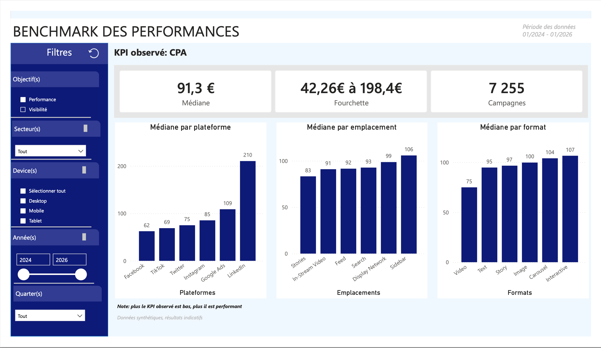
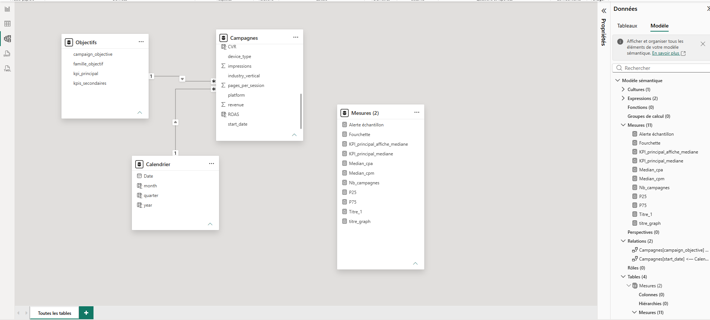

# Benchmark des performances publicitaires (Power BI)

Dashboard de benchmarks pensé pour des commerciaux : à partir du profil d’un client (objectif, secteur, device, période), il indique ce qu’on peut raisonnablement attendre d’une campagne et quels leviers comparer (plateforme, emplacement, format).

> **Jeu de données synthétique** (10 000 campagnes fictives). Les chiffres sont illustratifs : le projet démontre une méthode, pas des résultats de marché.
>
> Source du jeu de données :https://www.kaggle.com/datasets/juniornsa/digital-advertising-campaign-performance-dataset



## Objectif

Un commercial prépare un rendez-vous avec un client dont il connaît l’objectif, le secteur et le device. Le dashboard lui répond à trois questions :

1. Quel résultat typique attendre pour ce profil de campagne ?
2. Dans quelle fourchette se situent la moitié des campagnes comparables ?
3. Quelle plateforme, quel emplacement, quel format privilégier ?

## Données

Un fichier CSV d’une ligne par campagne : 10 000 campagnes, 35 colonnes (objectif, plateforme, emplacement, device, format, secteur, budget, dépense, impressions, clics, conversions, revenu, etc.), de janvier 2024 à janvier 2026.

| Objectif | Campagnes |
|---|---|
| Lead Generation | 3 563 |
| Conversions | 2 946 |
| Brand Awareness | 2 043 |
| App Installs | 746 |
| Engagement | 702 |

## Outils

Power BI Desktop (Power Query, modélisation, DAX).

## Choix de conception

**Deux familles d’objectifs.** La notion de performance dépend de l’objectif : une campagne de notoriété cherche à être vue, pas à générer des clics. Les objectifs sont donc regroupés en deux familles, avec un KPI principal chacune.

| Famille | Objectifs | KPI principal | Lecture |
|---|---|---|---|
| Visibilité | Brand Awareness, Engagement | CPM (coût pour 1 000 impressions) | plus bas = mieux |
| Performance | Conversions, Lead Generation, App Installs | CPA (coût par conversion) | plus bas = mieux |

**Médiane et fourchette P25 à P75, plutôt que la moyenne.** Quelques campagnes extrêmes tirent une moyenne. La médiane décrit la campagne typique, et la fourchette (du 25e au 75e percentile) contient la moitié des campagnes du milieu : c’est ce qu’un commercial peut annoncer à un client.

**KPI calculés campagne par campagne.** Un benchmark repose sur ce que fait une campagne typique : les ratios sont donc calculés pour chaque campagne, puis agrégés par médiane. Ce n’est pas la même chose qu’un ratio global (total des clics ÷ total des impressions).

**Seuil de fiabilité de 30 campagnes.** En dessous, le résultat est masqué et une alerte s’affiche. Le seuil de 30 est une convention courante, pas une règle absolue.

## Préparation des données (Power Query)

- `campagnes_brut` : lecture du CSV complet. **Chargement désactivé** : la requête sert de source et n’est pas chargée dans le modèle.
- `Campagnes` : créée **par référence** à `campagnes_brut`. Seules les colonnes utiles sont conservées (étape « Choisir les colonnes » : **À COMPLÉTER : liste**).
- Dates : `start_date` est au format jour/mois/année. La conversion utilise les paramètres régionaux français, pour éviter qu’un 6 mars soit lu comme un 3 juin.
- `Objectifs` : petite table créée dans Power Query (5 lignes) qui associe chaque objectif à sa famille et à son KPI principal.

Cette organisation garde les données brutes intactes et allège le modèle. À 10 000 lignes, le gain de performance reste modeste, mais la structure s’applique à des volumes plus importants.

## Modèle de données



- `Objectifs` → `Campagnes` (un-à-plusieurs, sur l’objectif)
- `Calendrier` → `Campagnes` (un-à-plusieurs, sur la date de début)

Une table de faits unique, complétée par deux petites dimensions. L’intérêt du projet est ailleurs que dans la modélisation : logique de KPI, benchmark et lisibilité.

## KPI et mesures DAX

**Colonnes calculées par campagne** (la division par zéro renvoie un vide) :

```
CPM  = DIVIDE ( Campagnes[ad_spend], Campagnes[impressions] ) * 1000
CPA  = DIVIDE ( Campagnes[ad_spend], Campagnes[conversions] )
CTR  = DIVIDE ( Campagnes[clicks], Campagnes[impressions] )
CVR  = DIVIDE ( Campagnes[conversions], Campagnes[clicks] )
ROAS = DIVIDE ( Campagnes[revenue], Campagnes[ad_spend] )
```

**Mesures du dashboard :**

```
Median_cpm = MEDIAN ( Campagnes[CPM] )
Median_cpa = MEDIAN ( Campagnes[CPA] )

KPI_principal_mediane =
SWITCH (
    SELECTEDVALUE ( Objectifs[famille_objectif] ),
    "Visibilité", [Median_cpm],
    "Performance", [Median_cpa]
)

P25 =
SWITCH (
    SELECTEDVALUE ( Objectifs[famille_objectif] ),
    "Visibilité", PERCENTILE.INC ( Campagnes[CPM], 0.25 ),
    "Performance", PERCENTILE.INC ( Campagnes[CPA], 0.25 )
)

Nb_campagnes = DISTINCTCOUNT ( Campagnes[campaign_id] )

KPI_principal_affiche =
IF ( [Nb_campagnes] < 30, BLANK (), [KPI_principal_mediane] )
```

`P75` suit la même logique que `P25` avec le percentile 0,75, et `Fourchette` assemble les deux bornes dans un texte. Une mesure `SWITCH` unique permet de garder **une seule page** : seul le KPI change selon la famille choisie.

## Le dashboard

- **Filtres** : famille d’objectifs (sélection unique), secteur, device, année, trimestre.
- **Cartes** : médiane du KPI principal, fourchette P25 à P75, nombre de campagnes.
- **Trois graphiques** : médiane par plateforme, par emplacement et par format, triés du meilleur au moins bon.
- **Garde-fous** : un message d’alerte et des barres masquées sous 30 campagnes, un titre qui indique le KPI observé.
- **Bouton de réinitialisation** : une icône (flèche circulaire) active un signet « sans filtre » qui remet tous les filtres à zéro. Tant qu’aucune famille d’objectifs n’est choisie, le dashboard invite à en sélectionner une.
- **Exports PDF** : trois versions du dashboard sont fournies, sans sélection d’objectif, avec la famille Visibilité et avec la famille Performance.

## Vérifications

- Les colonnes calculées retombent sur les valeurs attendues, contrôlées à la main sur deux campagnes :

| | CPM | CPA | CTR | CVR | ROAS |
|---|---|---|---|---|---|
| CAMP_00001 | 13,52 | 448,23 | 0,61 % | 0,50 % | 0,32 |
| CAMP_00002 | 23,12 | 231,63 | 0,93 % | 1,07 % | 1,49 |

- Sans autre filtre, le nombre de campagnes vaut 2 745 pour Visibilité et 7 255 pour Performance, soit la somme des objectifs de chaque famille.
- Les mesures réagissent aux filtres : le nombre de campagnes baisse, la médiane se déplace et reste comprise entre P25 et P75.

## Constats

Famille Performance, sans autre filtre : CPA médian de **91,30**, fourchette de **42,26 à 198,44**. Ces constats sont **indicatifs** et valent « dans ce jeu de données ».

- **La plateforme pèse le plus.** Du CPA médian le plus bas au plus haut : Facebook (62), TikTok (69), Twitter (75), Instagram (85), Google Ads (109), LinkedIn (210).
- **L’emplacement et le format varient peu.** Entre 83 et 106 pour les emplacements, entre 75 et 107 pour les formats, alors que la fourchette complète va de 42 à 198 : ces écarts restent faibles face à la dispersion entre campagnes.
- **La vidéo a le CPA médian le plus bas** parmi les formats (75).

Ces résultats concordent avec l’analyse exploratoire que j’avais menée en Python sur le même jeu de données.

## Limites

- **Données synthétiques** : certaines combinaisons sont irréalistes (par exemple une plateforme associée à un emplacement incohérent).
- **Pas d’impressions visibles ni d’interactions.** Dans un contexte réel, le benchmark de notoriété se baserait sur ces indicateurs. Le CPM et le CTR servent ici de substituts imparfaits.
- **Les campagnes sans conversion** ont un CPA vide : la médiane du CPA ne s’appuie que sur celles qui ont converti, donc elle est plutôt optimiste. Le nombre de campagnes affiché les compte toutes.
- **Seuil de 30** : convention, non démontrée.
- **Pas de croisement entre leviers** (plateforme × format, par exemple) : les échantillons deviendraient trop petits.
- **Devise supposée** : le jeu de données ne la précise pas.
- **Association, pas causalité** : un écart entre deux leviers ne prouve pas qu’un levier fait mieux que l’autre.

## Pistes d’amélioration

- Ajouter le CTA et le retargeting comme leviers supplémentaires.
- Intégrer un filtre de budget (`budget_tier`), car les benchmarks d’un petit et d’un gros budget diffèrent.
- Afficher la fourchette P25 à P75 sur chaque barre des graphiques.
- Brancher le dashboard sur des données réelles, avec des impressions visibles et des interactions pour la famille Visibilité.
- Faire tester la page par de vrais commerciaux.

## Compétences mobilisées

- **Cadrage métier** : adapter les indicateurs à l’objectif de la campagne.
- **Power Query** : requête par référence, chargement désactivé, sélection de colonnes, table de correspondance.
- **DAX** : colonnes calculées, `MEDIAN`, `PERCENTILE.INC`, `SWITCH` avec `SELECTEDVALUE`, `DISTINCTCOUNT`.
- **Statistiques** : médiane, percentiles, taille d’échantillon.
- **Visualisation** : un seul dashboard lisible par un non-spécialiste, avec des garde-fous.
- **Interactivité** : bouton de réinitialisation des filtres basé sur un signet.

## Fichiers

- [`projet_powerbi_dashboard_campagnes.pbix`](projet_powerbi_dashboard_campagnes) : fichier Power BI
- Exports PDF du dashboard:
  - [`dashboard_campagne.pdf`](dashboard_campagne.pdf) : sans sélection d’objectif
  - [`dashboard_campagnes_visibilite.pdf`](dashboard_campagnes_visibilite.pdf) : famille Visibilité
  - [`dashboard_campagnes_perf.pdf`](dashboard_campagnes_perf.pdf) : famille Performance
- `images/` : captures du dashboard et du modèle
