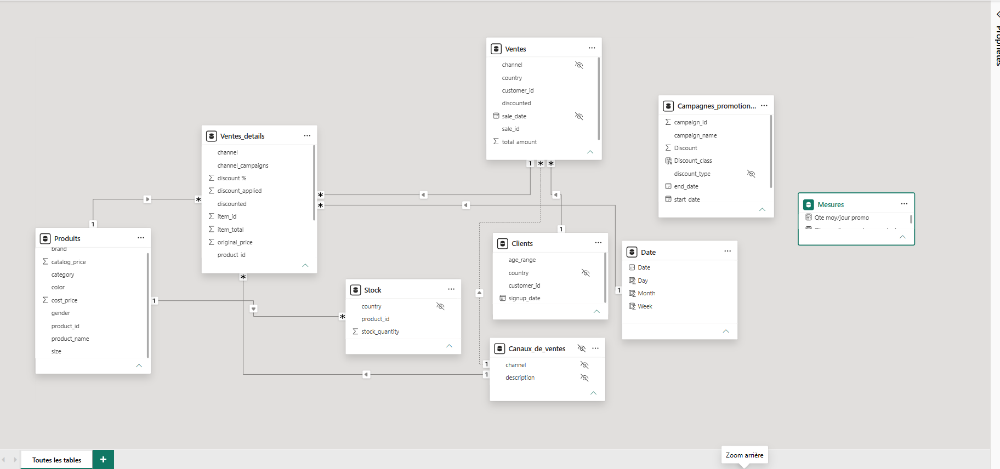
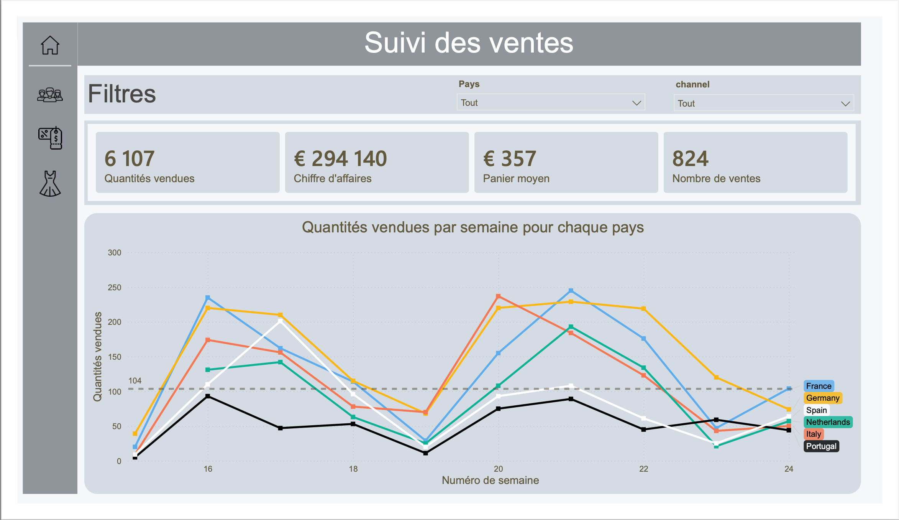
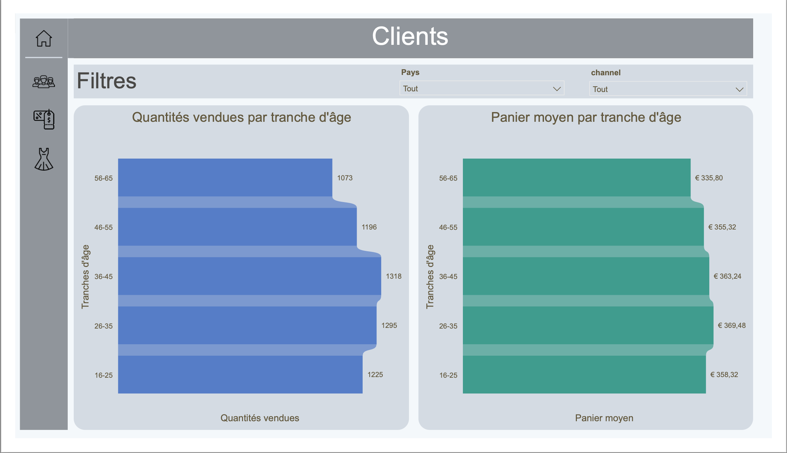
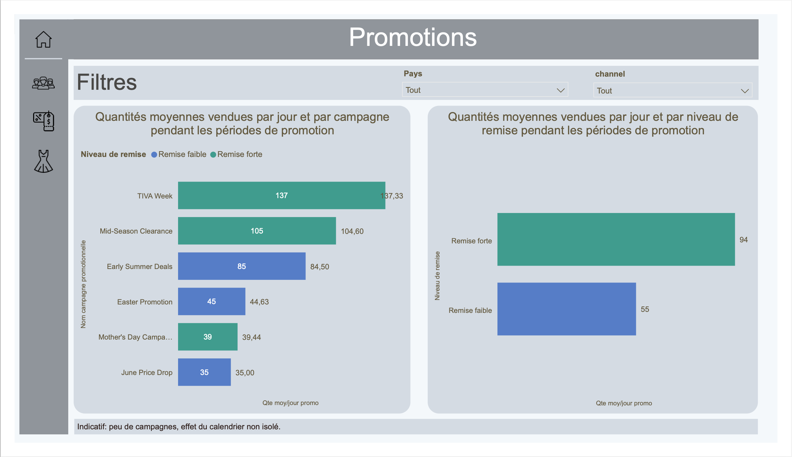
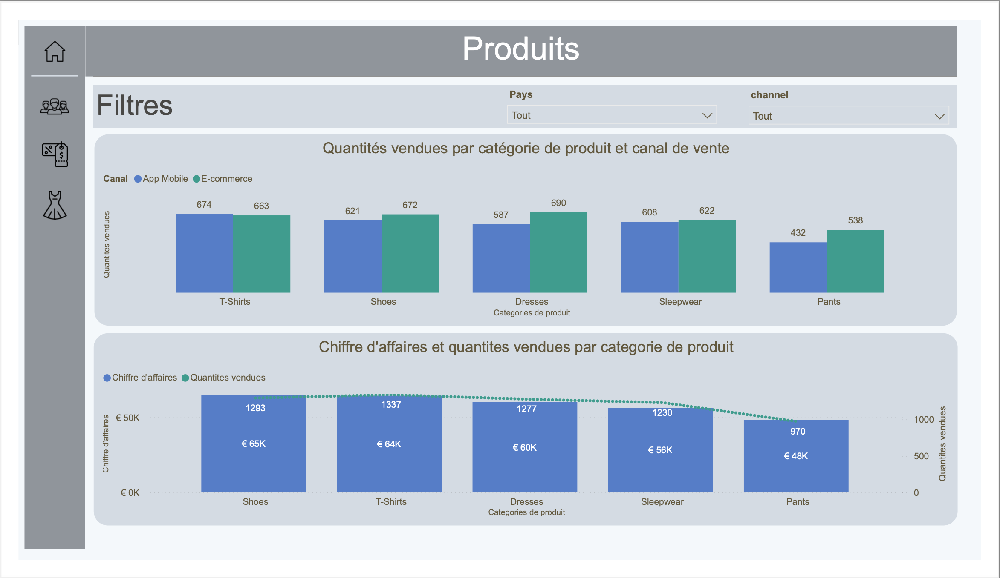

# Dashboard marketing : suivi des ventes et des promotions (Power BI)

Projet réalisé dans le cadre de ma formation en analyse de données. Le jeu de données est fictif (boutique de mode en ligne). Le rapport est pensé pour une équipe marketing qui veut suivre les ventes et les performances de ses promotions.

> Source du jeu de données : (https://www.kaggle.com/datasets/joycemara/european-fashion-store-multitable-dataset)

## Objectif

Répondre à quatre questions métier avec un rapport de quatre pages :

1. **Où et quand vend-on ?** Quantités vendues par pays et par semaine.
2. **Qui achète ?** Quantités et panier moyen par tranche d’âge.
3. **Quelles promotions se vendent le mieux ?** Quantité moyenne vendue par jour pendant chaque campagne, selon le niveau de remise.
4. **Que vend-on, et où ?** Quantités par catégorie de produit et par canal de vente, chiffre d’affaires par catégorie.

## Données

Période des ventes : du 4 avril au 17 juin 2025. Les analyses hebdomadaires portent sur les **10 semaines complètes** (du lundi 7 avril au dimanche 15 juin).

| Table | Contenu |
|---|---|
| `Ventes` | une ligne par vente (pays, canal, client, date, montant total) |
| `Ventes_details` | une ligne par article vendu (produit, quantité, prix, total de la ligne) |
| `Produits` | catégorie, marque, prix catalogue, coût, couleur, genre |
| `Clients` | tranche d’âge, pays, date d’inscription |
| `Stock` | quantité en stock par produit et par pays |
| `Campagnes_promotionnelles` | 7 campagnes : dates de début et de fin, type et niveau de remise, support de communication |
| `Canaux_de_ventes` | deux valeurs : E-commerce et App Mobile (écartée du modèle, voir plus bas) |

## Outils

Power BI Desktop (Power Query, modélisation, DAX) et PostgreSQL pour les requêtes de vérification.

## Préparation des données (Power Query)

| Problème rencontré | Ce que j’ai fait | Pourquoi |
|---|---|---|
| Remises stockées en 10, 25, 30 : passer la colonne en pourcentage affichait 1000 % | Division par 100 puis typage en pourcentage | Le format pourcentage multiplie par 100 à l’affichage |
| Colonne `channel` dans `Campagnes_promotion` qui désigne un support de communication, alors que `channel` désigne ailleurs le canal de vente | Renommée `Support_communication` | Éviter la confusion entre deux notions différentes |
| Aucune table de dates dans les données | Création d’une table `Date`, avec semaines commençant le lundi et indicateur « semaine complète » | Filtrer proprement par semaine et par plage de dates de campagne |
| Campagnes démarrant le 1er avril alors que les ventes commencent le 4 avril | Campagne tronquée écartée de l’analyse des promotions (Spring Flash Sale) | Une moyenne par jour calculée sur des jours sans données serait fausse |


## Modèle de données



**Relations principales** (toutes en un-à-plusieurs) :

- `Produits` → `Ventes_details`
- `Ventes` → `Ventes_details`
- `Clients` → `Ventes`
- `Calendrier` → `Ventes_details` (sur la date de vente)
- `Produits` → `Stock`

**Décisions de modélisation :**

- **Relation inactive corrigée.** La relation entre `Ventes` et `Ventes_details` était inactive : `Canaux_de_ventes` était reliée aux deux tables, ce qui créait deux chemins possibles. Comme le libellé du canal figure déjà dans les tables de faits, j’ai écarté `Canaux_de_ventes`, et la relation est redevenue active. Les filtres de pays et de tranche d’âge atteignent alors bien les quantités.
- **Une seule date de référence.** La table de dates n’est reliée qu’à `Ventes_details`, pour éviter plusieurs chemins entre deux dates de vente identiques.
- **`Campagnes_promotion` volontairement non reliée.** Une campagne est définie par une plage de dates (début et fin), qui ne se joint pas à la date unique d’une vente. Le calcul passe donc par des mesures DAX qui filtrent le calendrier sur la plage de chaque campagne.

## Mesures DAX

```
Nombre total de quantités vendues: 
Total_quantite = SUM ( Ventes_details[quantity] )

Chiffre d'affaires total:
Total_ca = SUM ( Ventes_details[item_total] )

Nombre total de ventes : 
Total_nb_ventes = DISTINCTCOUNT ( Ventes_details[sale_id] )

Panier moyen : 
Panier_moyen = DIVIDE ( [Chiffre d’affaires], [Nombre de ventes] )
```

Quantité moyenne vendue par jour pendant **une** campagne :

```
Qte moy/jour vendues pendant promo =
    VAR date_debut_campagne = MIN(Campagnes_promotionnelles[start_date])
    VAR date_fin_campagne = MAX(Campagnes_promotionnelles[end_date])
    VAR duree_campagne = DATEDIFF(date_debut_campagne,date_fin_campagne,DAY)+1
    VAR qte_vendues_par_campagne = CALCULATE(
                                            [Total_quantite], DATESBETWEEN('Date'[Date],date_debut_campagne,date_fin_campagne)
                                            )
RETURN DIVIDE(qte_vendues_par_campagne,duree_campagne)

```

Même mesure sur **un groupe** de campagnes (par niveau de remise, par support) : on calcule campagne par campagne, puis on moyenne. Sans cela, `MIN` et `MAX` prendraient les dates extrêmes du groupe, trous et autres campagnes compris.

```
Qté moy/jour promo =
AVERAGEX (
    VALUES ( Campagnes_promotionnelles[campaign_name] ),
    [Qté moy/jour pendant promo]
)
```

Colonne calculée pour regrouper les campagnes selon leur remise :

```
Niveau de remise = IF ( Campagnes_promotionnelles[Discount] < 0.2, "Remise faible", "Remise forte" )
```

## Pages du rapport

### 1. Suivi des ventes


Quatre indicateurs (quantités, chiffre d’affaires, panier moyen, nombre de ventes), une courbe des quantités par semaine et par pays, des filtres pays et canal.

### 2. Clients


Quantités et panier moyen par tranche d’âge, dans deux graphiques côte à côte (ce sont deux unités différentes, qu’il ne faut pas empiler).

### 3. Promotions


Quantité moyenne vendue par jour par campagne et par niveau de remise, avec un bandeau de prudence.

### 4. Produits


Quantités par catégorie et par canal de vente, puis chiffre d’affaires et quantités par catégorie.

## Vérifications

Chaque chiffre important a été contrôlé contre une requête SQL :

- Les totaux de quantités sont identiques d’une page à l’autre : **6 107 unités** sur les 10 semaines complètes (par tranche d’âge, par catégorie, par pays).
- Ma mesure pour la campagne TIVA Week (20 au 31 mai) donne **137,33 unités par jour**, soit 1 648 unités sur 12 jours, comme la requête SQL.
- Un contrôle de cohérence a repéré une erreur : une moyenne de groupe de 86 alors que les campagnes du groupe valaient entre 35 et 85, ce qui est impossible pour une moyenne. La cause était la lecture d’un seul `MIN` et `MAX` de dates pour tout le groupe. Corrigée avec `AVERAGEX`.

```sql
SELECT SUM(quantity)
FROM sales_items
WHERE sale_date BETWEEN '2025-05-20' AND '2025-05-31';
```

## Constats

Ces constats sont **indicatifs** (voir les limites).

- **Ventes cycliques** : creux simultanés dans presque tous les pays aux semaines 15, 19 et 23, suivis de reprises.
- **Clients** : les 36-45 ans achètent le plus (1 318 unités), les 26-35 ans ont le panier moyen le plus élevé (environ 369 €), les 56-65 ans sont derniers sur les deux mesures.
- **Produits** : les T-Shirts sont en tête en quantités (1 337), les chaussures en chiffre d’affaires (environ 65 K€), les pantalons sont derniers sur les deux. L’e-commerce devance l’app mobile dans 4 catégories sur 5.
- **Promotions** : TIVA Week est la campagne la plus forte (environ 137 unités par jour), June Price Drop la plus faible (35). Remises fortes : 94 unités par jour, remises faibles : 55 unités vendues.

## Limites

- **Campagnes promotionnelles non reliées aux ventes** : la comparaison se fait sur les périodes. 
- **Période courte** : 10 semaines de ventes et 6 campagnes analysées sur 7, donc 3 campagnes seulement par niveau de remise.
- **Promotions quasi permanentes** : seul le 16 au 30 avril est sans promotion, donc pas de période de référence « hors promo » exploitable.
- **Effet du calendrier non isolé** : les cycles de ventes se mélangent à l’effet des promotions (par exemple, deux des trois remises fortes tombent sur le pic de fin mai, alors que la troisième tombe sur un creux).


## Compétences mobilisées

- **Power Query** : typage, colonnes calculées, renommage, nettoyage.
- **Modélisation** : relations un-à-plusieurs, table de dates, résolution d’une relation inactive.
- **DAX** : `SUM`, `DISTINCTCOUNT`, `DIVIDE`, `CALCULATE`, `DATESBETWEEN`, variables, `AVERAGEX`, colonnes calculées.
- **SQL (PostgreSQL)** : agrégations, jointures, fonction de fenêtre (`RANK`) et requêtes de validation.
- **Visualisation** : choix du visuel selon la question, lisibilité, mise en garde sur les limites.

## Fichiers

- `Portfolio_PowerBI_ventes.pbix` : Fichier PowerBi
- `Portfolio_PowerBI_ventes.pdf` : Fichier PDF
- `images/` : captures du modèle et des quatre pages
